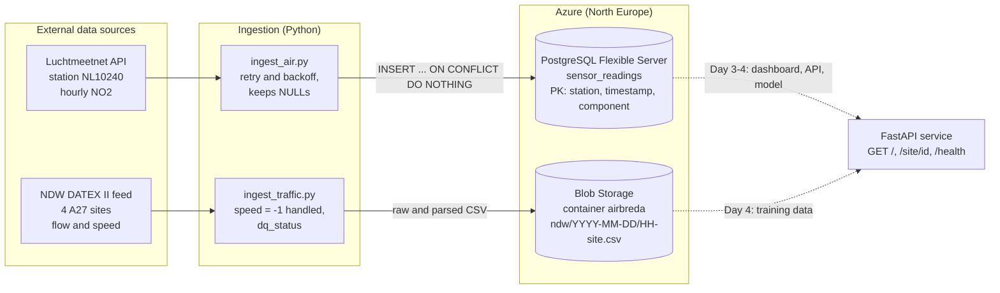

# AirBreda Architecture (Day 1)

## Components
- **Luchtmeetnet API**: public RIVM API, no key, hourly readings, can return null values.
- **NDW feed**: gzip-compressed DATEX II XML, one measurement per lane.
- **PostgreSQL**: structured readings, idempotent writes, time-range queries.
- **Blob Storage**: durable raw record, cheap, allows re-parsing later.
- **Dashed lines**: planned for Days 3 and 4.