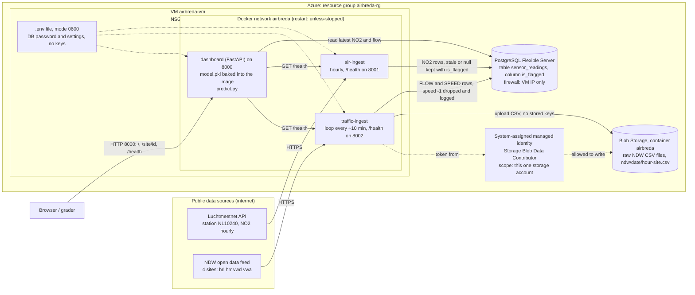

# AirBreda architecture (as deployed, 2026-11-28)

## Where the model lives and how the dashboard uses it

`model.pkl` is trained offline (`build_training_data.py`, then `train_model.py`) and copied into the
dashboard's Docker image at build time. At runtime `dashboard.py` imports `predict.py`, which loads
the file once. For each `/site/{id}` request the dashboard reads the latest NO2 and the latest flow
of all four sites from PostgreSQL, calls `predict(total_flow, hour_of_day)` and returns the
predicted NO2 and the exceedance risk. Retraining means rebuilding the image (ADR-006).

## Trust boundaries (who can access what)

| Principal | Can reach | How it is controlled |
|---|---|---|
| Anyone on the internet | Only port 8000 on the VM (dashboard, read-only) | NSG rule `allow-dashboard`; nothing else is exposed |
| Me (administration) | SSH port 22 on the VM | NSG rule `default-allow-ssh`, limited to my IP |
| VM managed identity | Blob container `airbreda` (read and write) and nothing else in Azure | Role Storage Blob Data Contributor, scoped to the one storage account; no keys on the VM |
| Containers on the VM | PostgreSQL | Password in `.env` (mode 0600, not in Git or the image); the server firewall allows the VM's IP only |
| Dashboard container | PostgreSQL (read) and the two `/health` endpoints | Same `.env`; it does not use Blob Storage |

Known limits: the managed identity belongs to the whole VM, so the dashboard container could in
principle use it too, even though it never does; and the database password is a shared secret in a
file. Per-container identities and a secret store (for example Key Vault) are the production fix.

Note: Redis (a queue between ingestion and storage, ADR-002) runs only in the local Compose setup
for testing. It is not part of the deployed system, where the ingestion containers write directly
to PostgreSQL.