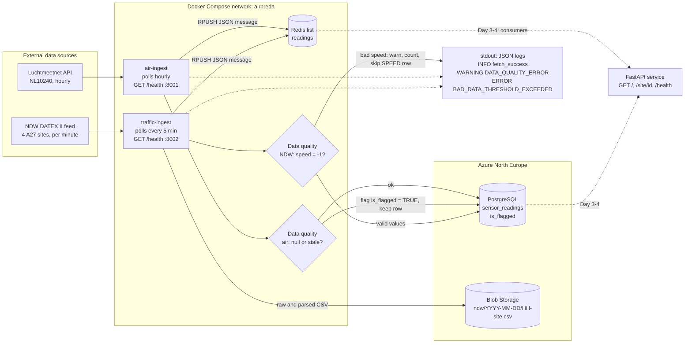

# AirBreda Architecture (after Day 2)

## Paths
- **Queue path:** both ingestion services publish every reading as JSON to the Redis list `readings`. Nothing consumes it yet. If Redis is down, ingestion logs the error and continues (ADR-002).
- **Logging path:** each service writes one JSON object per line to stdout (`fetch_success`, `DATA_QUALITY_ERROR`, `BAD_DATA_THRESHOLD_EXCEEDED`, ...). A monitoring tool added on Day 4 or 5 can filter on the `event` field.
- **Data quality path:** Luchtmeetnet null or stale readings are stored with `is_flagged = TRUE` (kept). NDW `speed = -1` is warned about, counted in `ndw_bad_data_count`, and never written to the database (dropped).
- **Health:** each service exposes `GET /health` with `last_successful_fetch`, `bad_data_count` and `source`.
- **Dashed lines:** planned for Days 3 and 4.