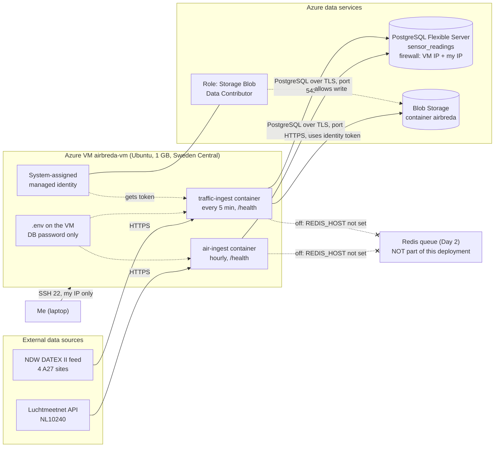

# AirBreda Architecture (after Day 3)

## What runs where
- **VM:** two containers, started with `--restart unless-stopped`. Each loops on its own timer and serves `/health` inside the VM (no public port).
- **VM to database:** PostgreSQL over TLS on port 5432. The database firewall allows only the VM's public IP and my own IP.
- **VM to object storage:** HTTPS using a token from the VM's managed identity. The identity has the `Storage Blob Data Contributor` role on this one storage account. No key is stored on the VM.
- **Day 2 queue:** not part of this deployment. Ingestion writes directly to the database and bucket; the Redis code stays in the repo but is switched off.
- **Access:** SSH only from my current IP; the database password is the only secret on the VM (`.env`, mode 600).